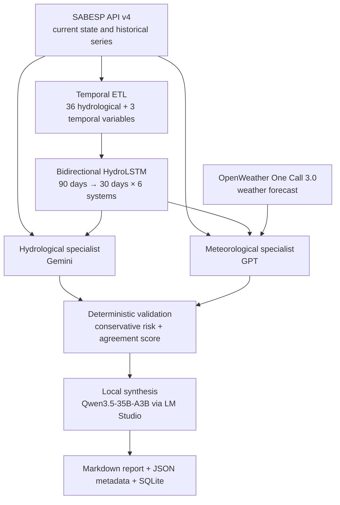

# HydraIA

**Brazilian Undergraduate Thesis (Trabalho de Conclusão de Curso — TCC) ·
Final-year Computer Engineering Capstone Project · FMU, Brazil · 2026**

[Português](README.md) · [Academic context](docs/ACADEMIC_CONTEXT.md) ·
[Final thesis PDF](paper/HydraIA_TCC.pdf) · [How to cite](CITATION.cff)

HydraIA is **José Enoque Fernandes de Sousa's undergraduate thesis repository**.
It is a research prototype for water-risk analysis in the São Paulo
Macrometropolitan Area. The system combines SABESP time series, a HydroLSTM
network, weather forecasts and an ensemble of large language models to produce
traceable technical reports.

> **Research scope:** this is an academic Computer Engineering artifact. It is
> not a SABESP operational system, does not replace official hydrological
> forecasting and must not be the sole basis for water-safety decisions.

## Audited results

An independent re-evaluation of the checkpoint/dataset pair found in the local
workspace on 8 August 2026 produced:

| Split | Windows | MAE | RMSE |
|---|---:|---:|---:|
| Validation (2023, after lookback/horizon) | 246 | 7.04 pp | 8.80 pp |
| Test (2024–10 April 2026, after lookback/horizon) | 712 | 6.19 pp | 7.57 pp |

These values reproduce the currently available artifacts. The delivered thesis
reported a validation value of 0.35 and a test MAE of 6.05 pp; the first value
was calculated in standardized space, and the historical metrics file predates
the current checkpoint. See the [scientific errata](docs/ERRATA.md) and the
[audited evaluation](artifacts/model_evaluation.json).

An archived forecast issued on 7 May 2026 was also compared with observations
later published by SABESP. For Cantareira over seven days, it achieved a 0.38 pp
MAE and 0.40 pp RMSE. The predicted medium-term direction was compatible with
five of the six modeled systems through 6 June. This is a scoped retrospective
audit, not evidence of universal accuracy or probabilistic calibration. See the
[May-to-June audit](docs/VALIDACAO_MAIO_JUNHO_2026.md).

## Architecture



The ensemble score is an **auditable agreement heuristic**, not a calibrated
probability. See [Methodology and mathematics](docs/METHODOLOGY.md).

## Quick start

Recommended requirements: Python 3.12 and `pip`. The offline demonstration does
not require API keys, a GPU, historical data or LM Studio.

```bash
python -m venv .venv
# Windows: .venv\Scripts\activate
# Linux/macOS: source .venv/bin/activate
python -m pip install -r requirements.txt

python -m src.cli run --modo-simulado --skip-llm --skip-preflight
```

For the complete pipeline:

```bash
cp .env.example .env  # Windows: copy .env.example .env
python -m src.cli validate --strict --sondar-modelos
python -m src.cli run
```

The complete mode requires the keys documented in `.env.example`, trained
artifacts and a chat LLM available through LM Studio at
`http://localhost:1234`. See [Local model and GPU profile](docs/LOCAL_MODEL.md).

## Reproduce the research

```bash
# 1. Download public SABESP series
python scripts/baixar_base_sabesp.py

# 2. Build the dataset with temporal splits
python -m src.data.preparar_dataset

# 3. Train and evaluate HydroLSTM
python -m src.data.treinar_modelo_ts --seed 42

# 4. Audit an existing checkpoint
python scripts/avaliar_modelo.py
```

Raw data, weights, caches and credentials are not part of Git. See the
[Reproducibility guide](docs/REPRODUCIBILITY.md), [Data Card](docs/DATA_CARD.md)
and [Model Card](docs/MODEL_CARD.md).

## Tests and quality

```bash
python -m pip install -r requirements-dev.txt
python -m pytest -q
ruff check src tests scripts
```

The suite covers collection and schemas, atomic caching, circuit breakers,
budget controls, CLI behavior, baselines, temporal separation, the ensemble,
semantic validation and an offline end-to-end run. CI performs offline tests and
critical static analysis without calling paid APIs.

## Academic material

- [Delivered undergraduate thesis PDF](paper/HydraIA_TCC.pdf)
- [Final presentation](presentation/HydraIA_Apresentacao.pdf)
- [Academic context and international terminology](docs/ACADEMIC_CONTEXT.md)
- [Software architecture](docs/ARCHITECTURE.md)
- [Methodology and mathematics](docs/METHODOLOGY.md)
- [Local model and GPU](docs/LOCAL_MODEL.md)
- [Real operational validation](docs/VALIDACAO_REAL.md)
- [May-to-June forecast audit](docs/VALIDACAO_MAIO_JUNHO_2026.md)
- [Scientific errata and limitations](docs/ERRATA.md)
- [Publication scope](docs/PUBLICATION_SCOPE.md)
- [Citation metadata](CITATION.cff)

The delivered thesis is preserved unchanged. Post-submission corrections and
improvements are explicitly identified to maintain academic traceability.

## Public structure

```text
src/             pipeline implementation
tests/           automated offline tests
scripts/         acquisition, export and evaluation
docs/            architecture, method, cards and limitations
artifacts/       small metadata and evaluations, without data/weights
paper/           delivered undergraduate thesis PDF
presentation/    final presentation PDF
```

## Security and license

Never commit `.env`, tokens, caches, raw data, weights or administrative
documents. See [SECURITY.md](SECURITY.md).

Provider keys authenticate outgoing requests; this CLI does not issue user
sessions. OpenWeather requires HTTPS, and LM Studio accepts HTTP only on
loopback. Remote endpoints require HTTPS. The security document explains
credential flow, rotation and the limits of diagnostic redaction.

Copyright © 2026 José Enoque Fernandes de Sousa. The content is available for
reading and academic assessment; no reuse rights are granted without express
permission. See [LICENSE](LICENSE).
