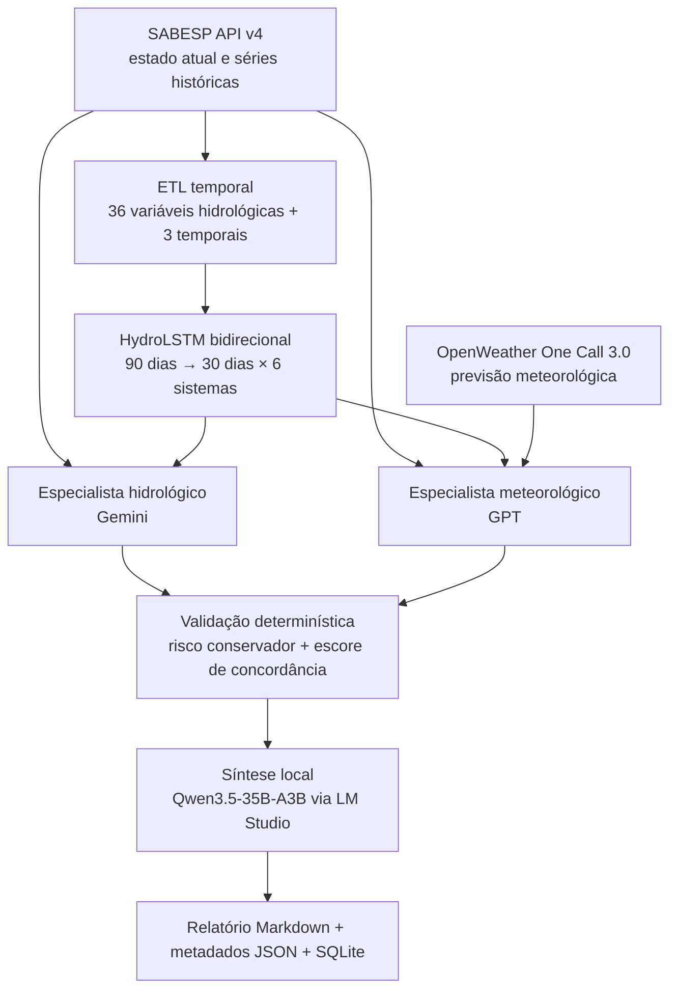

# HydraIA

**Brazilian Undergraduate Thesis (Trabalho de Conclusão de Curso — TCC) ·
Final-year Computer Engineering Capstone Project · FMU, Brazil · 2026**

[English](README.en.md) · [Contexto acadêmico internacional](docs/ACADEMIC_CONTEXT.md) ·
[Artigo final](paper/HydraIA_TCC.pdf) · [Como citar](CITATION.cff)

Protótipo de pesquisa para análise de risco hídrico na Macrometrópole de São Paulo. O sistema combina séries temporais da SABESP, uma rede HydroLSTM, previsão meteorológica e um ensemble de modelos de linguagem para produzir relatórios técnicos rastreáveis.

> **Escopo:** artefato acadêmico de Engenharia de Computação. Não é um sistema operacional da SABESP, não substitui previsão hidrológica oficial e não deve fundamentar sozinho decisões de segurança hídrica.

## Resultado auditado

O repositório foi preparado para publicação a partir do código final, do artigo entregue e dos artefatos locais disponíveis. A reavaliação independente do par checkpoint/dataset encontrado em 08/08/2026 produziu:

| Partição | Janelas | MAE | RMSE |
|---|---:|---:|---:|
| Validação (2023, após lookback/horizonte) | 246 | 7,04 pp | 8,80 pp |
| Teste (2024–10/04/2026, após lookback/horizonte) | 712 | 6,19 pp | 7,57 pp |

Esses valores são os resultados reproduzidos dos artefatos atuais. O artigo entregue registra 0,35 para validação e 6,05 pp para teste; o primeiro valor foi calculado no espaço padronizado e o arquivo de métricas é anterior ao checkpoint atual. Consulte a [errata científica](docs/ERRATA.md) e a [avaliação auditada](artifacts/model_evaluation.json).

## Arquitetura



O escore do ensemble é uma **heurística auditável de concordância**, não uma probabilidade calibrada. A formulação completa está em [Metodologia](docs/METHODOLOGY.md).

## Início rápido

Requisitos recomendados: Python 3.12 e `pip`. A demonstração offline não exige chaves, GPU, dados históricos ou LM Studio.

```bash
python -m venv .venv
# Windows: .venv\Scripts\activate
# Linux/macOS: source .venv/bin/activate
python -m pip install -r requirements.txt

python -m src.cli run --modo-simulado --skip-llm --skip-preflight
```

Para executar o pipeline completo:

```bash
cp .env.example .env  # no Windows: copy .env.example .env
python -m src.cli validate --strict --sondar-modelos
python -m src.cli run
```

O modo completo requer as chaves descritas em `.env.example`, os artefatos treinados e um LLM de chat disponível no LM Studio em `http://localhost:1234`. O perfil recomendado para a máquina de referência está em [Modelo local e GPU](docs/LOCAL_MODEL.md).

## Reproduzir a pesquisa

```bash
# 1. Baixar as séries públicas da SABESP
python scripts/baixar_base_sabesp.py

# 2. Construir o dataset com splits temporais
python -m src.data.preparar_dataset

# 3. Treinar e avaliar o HydroLSTM
python -m src.data.treinar_modelo_ts --seed 42

# 4. Auditar um checkpoint existente
python scripts/avaliar_modelo.py
```

Os dados brutos, pesos, caches e credenciais não fazem parte do Git. Veja [Reprodutibilidade](docs/REPRODUCIBILITY.md), [Data Card](docs/DATA_CARD.md) e [Model Card](docs/MODEL_CARD.md).

## Testes e qualidade

```bash
python -m pip install -r requirements-dev.txt
python -m pytest -q
ruff check src tests scripts
```

A suíte cobre coleta e schemas, cache atômico, circuit breaker, orçamento, CLI, baselines, separação temporal, ensemble, validação semântica e execução simulada ponta a ponta. O workflow de CI executa testes offline e análise estática crítica sem chamar APIs pagas.

## Material acadêmico

- [Contexto acadêmico e terminologia internacional](docs/ACADEMIC_CONTEXT.md)
- [Artigo final do TCC / Undergraduate Thesis](paper/HydraIA_TCC.pdf)
- [Apresentação em PDF](presentation/HydraIA_Apresentacao.pdf)
- [Arquitetura de software](docs/ARCHITECTURE.md)
- [Metodologia e matemática](docs/METHODOLOGY.md)
- [Modelo local e GPU](docs/LOCAL_MODEL.md)
- [Validação operacional real](docs/VALIDACAO_REAL.md)
- [Auditoria da previsão maio-junho de 2026](docs/VALIDACAO_MAIO_JUNHO_2026.md)
- [Errata e limitações](docs/ERRATA.md)
- [Escopo da publicação](docs/PUBLICATION_SCOPE.md)
- [Como citar](CITATION.cff)

O artigo é preservado como foi entregue. Correções posteriores aparecem na errata para manter a rastreabilidade acadêmica.

## Estrutura pública

```text
src/             implementação do pipeline
tests/           testes automatizados offline
scripts/         aquisição, exportação e avaliação
docs/            arquitetura, método, cards e limitações
artifacts/       metadados e avaliações pequenas, sem dados/pesos
paper/           artigo final em PDF
presentation/    apresentação final em PDF
```

## Segurança e licença

Nunca versione `.env`, tokens, caches, dados brutos, pesos ou entregas administrativas. O arquivo local `.env` está excluído pelo `.gitignore`. Consulte [SECURITY.md](SECURITY.md).

As chaves autenticam chamadas de saída aos provedores; o CLI não possui sessões
de usuário. O OpenWeather usa HTTPS e o LM Studio aceita HTTP somente em loopback;
destinos remotos exigem HTTPS. Veja o [fluxo de credenciais, rotação e limites dos
diagnósticos](SECURITY.md#componentes-credenciais-e-fluxo).

Copyright © 2026 José Enoque Fernandes de Sousa. O conteúdo é disponibilizado para leitura e avaliação acadêmica; nenhum direito de reutilização é concedido sem autorização expressa. Consulte [LICENSE](LICENSE).
