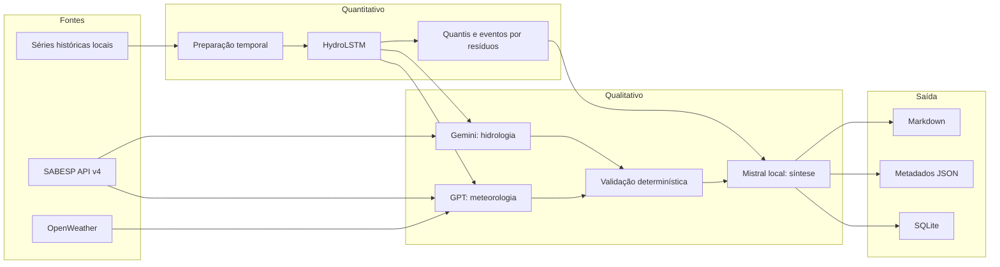

# Arquitetura do HydraIA

## Visão de contexto

HydraIA é um pipeline batch/CLI, não uma aplicação web. O limite de confiança do sistema termina na geração de um relatório técnico: ações operacionais permanecem sob responsabilidade humana.

## Camadas

### Aquisição

- `src/api/sabesp.py`: schemas defensivos, retries, circuit breaker, snapshots opcionais e persistência da coleta.
- `src/api/openweather.py`: previsão diária opcional; sua indisponibilidade não interrompe o pipeline.
- `scripts/baixar_base_sabesp.py`: aquisição histórica assíncrona para reprodução local.

### Dados e modelagem

- `src/data/preparar_dataset.py`: consolida 36 séries hidrológicas, cria três variáveis sazonais, separa por data, padroniza e forma janelas.
- `src/data/modelo_lstm.py`: única definição da HydroLSTM usada por treino e inferência.
- `src/data/treinar_modelo_ts.py`: treinamento determinístico, early stopping, baselines e avaliação desnormalizada.
- `src/data/inferencia_ts.py`: inferência pontual, intervalos empíricos por resíduos de validação e probabilidades de limiar.

### Ensemble

- `src/core/llm_specialists.py`: Strategy + Template Method para chamada, retry, parsing e schema.
- `src/core/orquestrador.py`: Dependency Injection, paralelismo I/O, validação cruzada, síntese e proveniência da saída.
- `src/core/validacao_semantica.py`: regras explícitas de schema, plausibilidade física e concordância semântica.

### Operação

- `src/cli.py`: `validate`, `preflight`, `dry-run`, `run` e `metrics`.
- `src/utils/cache.py`: cache com TTL e escrita atômica.
- `src/utils/circuit_breaker.py`: isolamento de integrações instáveis.
- `src/utils/budget.py`: limites de chamadas, tokens estimados e tempo de parede.
- `src/utils/observabilidade.py`: correlation ID, logs mascarados, métricas e hash de versão.
- `src/utils/persistence.py`: histórico estruturado em SQLite.

## Decisões de engenharia

1. **Aritmética fora dos LLMs.** Estatísticas, probabilidades e ajustes do ensemble são calculados em Python; os LLMs interpretam estruturas já calculadas.
2. **Risco conservador.** Com dois especialistas válidos, o risco consolidado é o maior nível informado.
3. **Falha explícita ou fallback identificado.** SABESP pode operar em `real`, `snapshot` ou `simulado`; a previsão marca `hydrolstm`, `baseline_climatologia` ou `baseline_persistence`.
4. **Reprodução offline.** O modo simulado não consulta rede nem reutiliza silenciosamente climatologia local.
5. **Artefatos fora do Git.** Pesos, dados brutos e caches são regeneráveis e exigem revisão própria de licença/proveniência.

## Limites arquiteturais

- Não há API pública, dashboard, autenticação multiusuário ou implantação contínua.
- OpenWeather alimenta apenas o especialista meteorológico; não é feature da HydroLSTM atual.
- O sintetizador local é ponto único de disponibilidade no modo completo.
- SQLite é adequado ao protótipo local, não a coordenação distribuída.
- O escore de concordância não foi calibrado contra avaliação humana ou desfechos hidrológicos.
